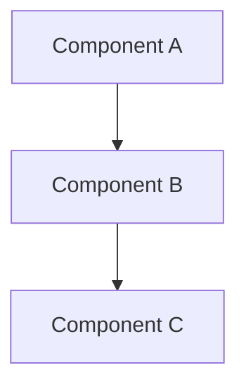

# Write an Architecture Decision Record (ADR)

Use this skill when documenting a significant architecture or technology decision.

## Steps

### 1. Determine the Next ADR Number

```bash
ls docs/architecture/ADR-*.md | sort | tail -1
# If last file is ADR-005-xxx.md, next is ADR-006
```

### 2. Create the ADR File

File: `docs/architecture/ADR-00N-kebab-case-title.md`

### 3. Use This Template

```markdown
# ADR-00N: Title of Decision

**Status**: Proposed
**Date**: YYYY-MM-DD

## Context

Describe the problem, constraint, or opportunity that motivates this decision.
Include relevant technical context, business requirements, and any alternatives
that were considered.

## Decision

State the decision clearly. Explain why this option was chosen over alternatives.

### Alternatives Considered

1. **Alternative A** — Brief description. Rejected because...
2. **Alternative B** — Brief description. Rejected because...

## Consequences

### Positive
- Benefit 1
- Benefit 2

### Negative
- Trade-off 1
- Trade-off 2

### Neutral
- Observation that is neither positive nor negative

## Architecture Impact

Include a Mermaid diagram if the decision affects system architecture:



## References

- Relevant spec or RFC: `<insert URL>`
- Related ADR: `ADR-00N: Title` (`./ADR-00N-title.md`)
```

### 4. Status Lifecycle

- **Proposed** → Initial state, open for discussion
- **Accepted** → Team agreed, implementation can proceed
- **Deprecated** → No longer relevant (explain why)
- **Superseded by ADR-00N** → Replaced by a newer ADR (link to it)

### 5. Examples of Good ADR Titles

- `ADR-001-use-keycloak-for-authentication.md`
- `ADR-002-choose-traefik-over-nginx.md`
- `ADR-003-langgraph-for-atc-agent-orchestration.md`
- `ADR-004-qdrant-for-vector-search.md`
- `ADR-005-rust-websocket-gateway.md`
- `ADR-006-organization-seat-multi-tenancy.md`

### 6. Review Checklist

- [ ] Clear problem statement in Context
- [ ] Decision states the "what" and "why"
- [ ] Alternatives were documented (even if briefly)
- [ ] Consequences include both positive and negative
- [ ] Mermaid diagram included if architecture changes
- [ ] References link to relevant specs or prior ADRs
