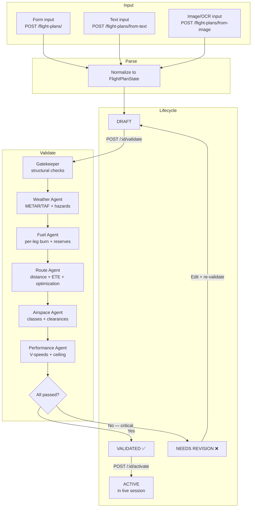
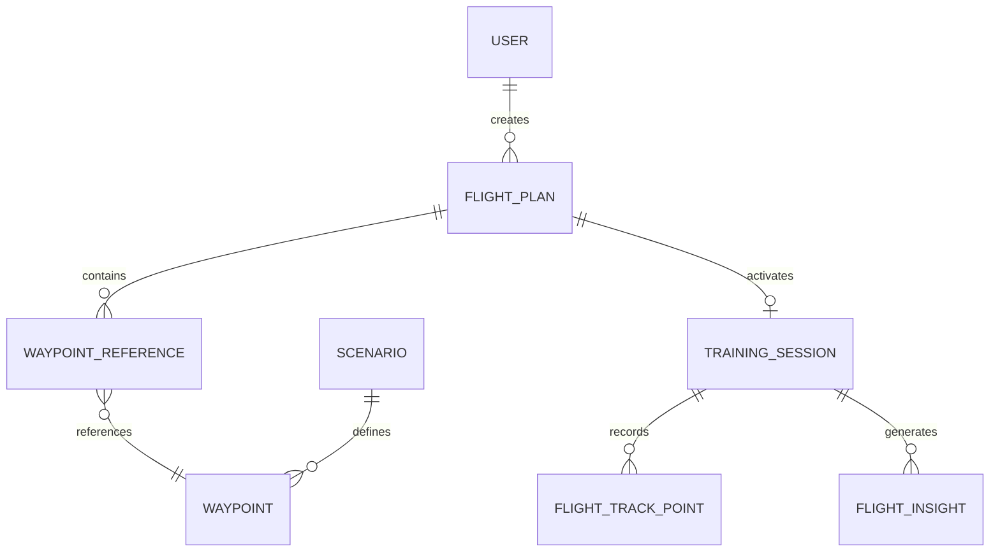

# 005 — Flight Plan Pipeline

**Status**: Accepted
**Date**: 2025-07-14

## Context

Flight plan creation is the entry point to every Horus training session. Students need
to build a complete VFR or IFR flight plan — specifying departure/arrival airports,
route waypoints, fuel, weight, and aircraft type — before the AI can simulate a
realistic ATC interaction.

The challenge is that student skill levels vary enormously:

- A beginner might only be able to fill out a form with airport codes and aircraft type.
- An intermediate student might paste a text flight plan from ForeFlight or SkyVector.
- An advanced student or instructor might upload a scanned paper flight plan (image/OCR).

Once a flight plan exists, it must be **validated** against multiple domains (weather,
fuel, airspace, performance) before it can be used in a live session. This validation
is the same pipeline described in [ADR-004](./004-langgraph-multi-agent.md).

We also need to support external data sources (weather APIs, airspace databases) that
don't exist yet in the MVP but must have clean interfaces for future integration.

## Decision

Implement a **multi-source flight plan pipeline** with three input methods, a shared
parse/normalize step, AI-powered validation via the LangGraph validation graph, and
explicit lifecycle states.

### Input Methods

| Method | Endpoint | Description |
|--------|----------|-------------|
| **Form** | `POST /api/v1/flight-plans/` | Structured JSON body matching `FlightPlanState` schema |
| **Text** | `POST /api/v1/flight-plans/from-text` | Free-form text parsed by the backend into structured data |
| **Image** | `POST /api/v1/flight-plans/from-image` | Uploaded image processed via OCR and then parsed into structured data |

All three methods converge to the same internal `FlightPlanState` TypedDict.

### Pipeline Flow

### Flight Plan Lifecycle States

| State | Description |
|-------|-------------|
| `draft` | Created but not yet validated. Student can edit freely. |
| `validated` | Passed all validation checks. Ready to activate. |
| `active` | Currently being used in a live training session. |
| `completed` | Session finished. Plan is archived with session data. |
| `rejected` | Failed validation with critical issues. Must be revised. |

### API Endpoints

| Method | Path | Description |
|--------|------|-------------|
| `GET` | `/api/v1/flight-plans/` | List flight plans for the current user |
| `POST` | `/api/v1/flight-plans/` | Create from structured form data |
| `POST` | `/api/v1/flight-plans/from-text` | Create from free-form text |
| `POST` | `/api/v1/flight-plans/from-image` | Create from uploaded image (OCR) |
| `GET` | `/api/v1/flight-plans/{id}` | Get flight plan details |
| `PUT` | `/api/v1/flight-plans/{id}` | Update a draft flight plan |
| `POST` | `/api/v1/flight-plans/{id}/validate` | Run validation graph against the plan |
| `POST` | `/api/v1/flight-plans/{id}/activate` | Activate for a live session |

### Waypoint Management

Flight plans reference waypoints stored in a dedicated table. Waypoints support:

| Method | Path | Description |
|--------|------|-------------|
| `GET` | `/api/v1/waypoints/` | Search waypoints by name, type, or bounding box |
| `POST` | `/api/v1/waypoints/` | Create a custom waypoint |
| `GET` | `/api/v1/waypoints/scenarios/{id}/waypoints` | Get waypoints for a scenario |
| `POST` | `/api/v1/waypoints/scenarios/{id}/waypoints` | Add waypoints to a scenario |
| `GET` | `/api/v1/waypoints/sessions/{id}/track` | Get recorded flight track |
| `GET` | `/api/v1/waypoints/sessions/{id}/insights` | Get AI-generated flight insights |

### External Service Interfaces

Weather, airspace, and NOTAM data are currently served by **stub implementations**
(`backend/app/services/llm/tools/`). Each stub has a clear function signature that
maps to a real API:

| Service | Stub location | Future real API |
|---------|--------------|-----------------|
| Weather (METAR/TAF) | `tools/weather_tools.py` → `fetch_metar()`, `fetch_taf()` | NOAA Aviation Weather API, CheckWX |
| Airspace | `tools/airspace_tools.py` → `get_route_airspace()` | OpenAIP, FAA NASR |
| NOTAM | *(not yet implemented)* | FAA NOTAM API |

Swapping a stub for a real API requires changing only the tool implementation — the
agent that calls it and the graph that orchestrates it remain unchanged.

### Data Model

## Consequences

### Positive

- **Multi-skill accessibility** — beginners use the form, advanced students paste text
  or upload images. All paths converge to the same validation pipeline.
- **Separation of input and validation** — input parsing is a simple normalization
  step; validation is the reusable LangGraph pipeline from ADR-004.
- **Explicit lifecycle** — the `draft → validated → active → completed` flow prevents
  students from starting sessions with invalid plans.
- **Swappable external services** — stub interfaces make it trivial to integrate real
  weather/airspace APIs without changing agent logic.
- **Session replay** — recorded flight track points and AI-generated insights enable
  post-session review with map visualization.

### Negative

- **OCR accuracy** — image-to-flight-plan parsing depends on OCR quality. Handwritten
  plans or poor scans will produce errors. The text parser must handle partial data
  gracefully.
- **Stub fidelity** — stub weather/airspace data is fabricated. Students may learn
  incorrect weather patterns until real APIs are integrated.
- **No offline support** — flight plan creation and validation require the backend.
  A future PWA mode could cache recent plans for offline review.

### Neutral

- **Three input endpoints** — adds API surface area, but each endpoint is thin (parse
  + normalize + save as draft). The real logic lives in the shared validation graph.
- **Waypoint table** — introduces a new database table and lookup semantics. This is
  standard for aviation applications and enables future features like SID/STAR support.

## References

- [FAA Flight Plan Form 7233-1](https://www.faa.gov/forms/faa7233_1)
- [ICAO Flight Plan Format (Doc 4444)](https://www.icao.int/airnavigation/Pages/flight-plan.aspx)
- Related ADR: [004 — LangGraph Multi-Agent Architecture](./004-langgraph-multi-agent.md)
- Related ADR: [002 — Database Selection](./ADR-002-database-postgresql.md)
