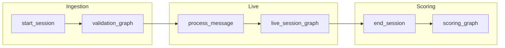
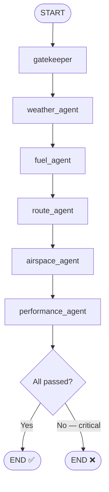
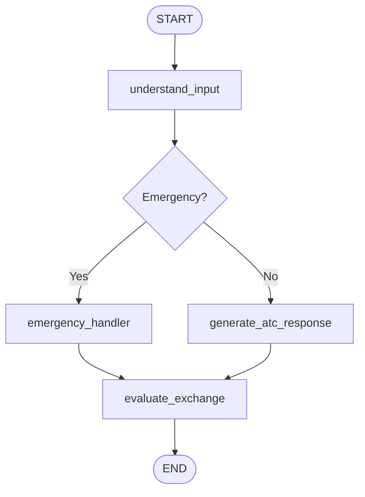
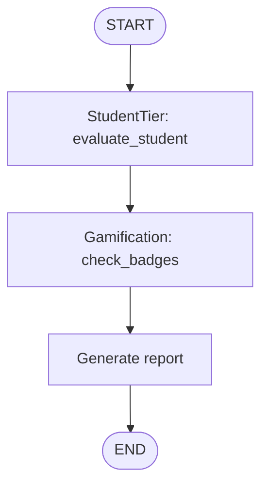
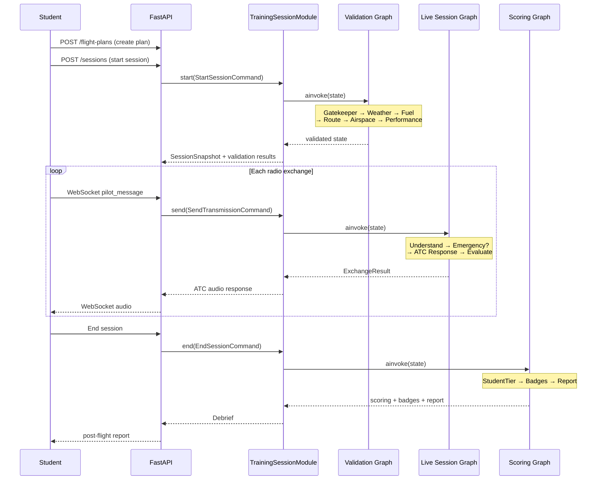

# ADR-004: LangGraph Multi-Agent Architecture

**Status**: Accepted
**Date**: 2025-07-14

## Context

Horus is an aviation training platform where student pilots practice ATC communication
against AI controllers. The initial MVP used a single Ollama LLM call per exchange — a
stateless prompt-in / response-out design. As the platform grew to include flight plan
validation, real-time emergency detection, post-session scoring, and gamification, a
single LLM call could no longer handle the breadth of reasoning required.

We needed an architecture that:

1. Decomposes aviation reasoning into **specialist domains** (weather, fuel, airspace, …)
   so each concern is independently testable and evolvable.
2. Supports a **multi-phase training lifecycle** — ingestion, validation, live ATC
   session, post-flight evaluation, and scoring.
3. Allows **human-in-the-loop (HITL)** so instructors can override AI-generated ATC
   responses before they reach the student.
4. Keeps state in a single, typed object so every agent can read context set by earlier
   agents (e.g., the fuel agent can reference route distances from the route agent).

## Decision

We adopt **LangGraph `StateGraph`** as the orchestration framework. **Three compiled
sub-graphs** and **nine specialized reasoning agents** run inside a single
caller-facing Session module.

> **Partly superseded.** The graph topology recorded below is current. The
> *composition* described in the original text is not: the `HorusOrchestrator`
> class and its `orchestrator.py` module were retired, and graphs are now built
> by factories that take an injected `LLMModule`. See
> [ADR-006](./ADR-006-scene-session-and-persistent-langgraph.md) for the Session
> module that replaced the orchestrator and for how state is persisted, and
> [ADR-007](./ADR-007-llm-provider-adapters.md) for provider injection.

### Session module (was: `HorusOrchestrator`)

`TrainingSessionModule` (`backend/app/services/training_sessions/session_module.py`)
is the single lifecycle seam. It is constructed once in the composition root,
`backend/app/main.py`, and exposes:

| Method | Pipeline phase | Sub-graph invoked |
|--------|---------------|-------------------|
| `start()` | Ingestion → Validation → Pre-flight | `build_validation_graph()` |
| `validate()` | Pre-flight only, nothing persisted | `build_validation_graph()` |
| `send()` | Live ATC exchange | `build_live_session_graph()` |
| `await_instructor()` | Completes a held exchange (override, or resume non-interrupting) | `build_live_session_graph()` |
| `end()` | Post-flight → Scoring → Badges | `build_scoring_graph()` |
| `snapshot()` | — | none (reads the persisted state) |

The validation and scoring graphs are built once in the module's constructor.
Live graphs are built per `(scene_version, interrupt_before_response)` pair and
cached, because the injected LLM and Scene are fixed per graph.

Each session's state is a single `HorusState` TypedDict that flows through every node.



### Shared State

All agents share one `HorusState` TypedDict (`backend/app/services/llm/state.py`).
Sub-states are nested TypedDicts so each agent reads and writes only its slice:

| State slice | Owner agent(s) | Key fields |
|-------------|---------------|------------|
| `flight_plan` | Input / Gatekeeper | `departure_icao`, `arrival_icao`, `route`, `fuel_on_board`, … |
| `weather` | Weather | `departure_metar`, `flight_category`, `hazards`, `briefing_text` |
| `fuel_state` | Fuel | `total_burn`, `reserve_available`, `sufficient`, per-leg breakdown |
| `route_info` | Route | `total_distance_nm`, per-leg heading/ETE, `suggestions` |
| `airspace_info` | Airspace | `intersections`, `required_clearances`, `required_equipment` |
| `aircraft_performance` | Performance | `v_speeds`, `density_altitude`, `altitude_ok` |
| `validation_results` | All validation agents | List of `{agent, passed, severity, message}` |
| `pilot_message` / `atc_response` | Live session | Current exchange text |
| `scoring` | StudentTier | `communication_score`, `overall_score`, `grade`, … |
| `badges_earned` | Gamification | List of badge slugs |

The `messages` field uses LangGraph's `add_messages` reducer for automatic merge of
conversation history.

### Session Phases

The pipeline progresses through seven phases defined in `SessionPhase`:

```
INGESTION → VALIDATION → PRE_FLIGHT → ACTIVE → POST_FLIGHT → SCORING → COMPLETE
```

### Sub-Graph 1: Validation Graph

**File**: `backend/app/services/llm/graphs/validation_graph.py`

Runs at session start to validate the student's flight plan before entering the live
ATC simulation. Six agents execute in sequence so later agents can reference earlier
results.



| Node | Agent | Responsibility |
|------|-------|---------------|
| `gatekeeper` | Gatekeeper | Structural validation: ICAO codes, route continuity, fuel > 0, weight limits, IFR alternate |
| `weather_agent` | Weather | Fetch METAR/TAF, determine flight category, extract hazards, generate briefing |
| `fuel_agent` | Fuel | Per-leg fuel burn, legal reserve check (VFR 30 min / IFR 45 min) |
| `route_agent` | Route | Distance, heading, ETE per leg; detect route inefficiency |
| `airspace_agent` | Airspace | Airspace class intersections, required clearances/equipment |
| `performance_agent` | Performance | V-speeds, density altitude, service ceiling check |
| `check_all_passed` | (built-in) | Aggregates all `validation_results`; fails on any `CRITICAL` severity |

### Sub-Graph 2: Live Session Graph

**File**: `backend/app/services/llm/graphs/live_session_graph.py`

Handles a **single pilot → ATC exchange**. The Session module invokes this once
per pilot transmission; conversation history accumulates in `HorusState.messages`.



| Node | Responsibility |
|------|---------------|
| `understand_input` | Classify pilot transmission: detect phraseology errors, positive patterns, and emergency keywords |
| `emergency_handler` | Classify emergency type (MAYDAY, PAN PAN, engine failure, etc.) and generate procedural ATC response from templates |
| `generate_atc_response` | Build context-aware prompt from the Scene and invoke the injected `LLMModule` for a standard ATC response |
| `evaluate_exchange` | Increment exchange counter, update session phase detail (taxi → takeoff → cruise → …) |

#### Human-in-the-Loop (HITL)

When compiled with `interrupt_before_response=True`,
`build_live_session_graph()` pauses before the ATC response node (and before the
emergency handler). An instructor can inspect the state, then either supply
their own response or let the graph finish. The flag is a constructor argument
of `TrainingSessionModule`; callers do not set it themselves, and
`await_instructor()` is what completes a held exchange. Because the state is
checkpointed, a pending instructor review survives a backend restart.

### Sub-Graph 3: Scoring Graph

**File**: `backend/app/services/llm/graphs/scoring_graph.py`

Runs after the session ends to evaluate performance and award badges.



| Node | Agent | Responsibility |
|------|-------|---------------|
| `student_eval` | StudentTier | Heuristic scoring: communication (35%), decisions (25%), procedures (25%), engagement (15%). Outputs grade A–F. |
| `badge_check` | Gamification | Evaluates 12 badge criteria against session scoring + cumulative student stats. Awards new badges. |
| `generate_report` | (built-in) | Assembles a formatted post-flight report with scores, strengths, improvements, badges, and session notes. |

### Agent Summary

| # | Agent | Graph | LLM required? | Description |
|---|-------|-------|---------------|-------------|
| 1 | **Gatekeeper** | Validation | No | Structural flight plan validation (ICAO codes, fuel, weight, route) |
| 2 | **Weather** | Validation | No (stub) | METAR/TAF fetch, flight category, hazard detection |
| 3 | **Fuel** | Validation | No | Per-leg fuel burn, reserve calculation |
| 4 | **Route** | Validation | No | Distance, heading, ETE, route optimization suggestions |
| 5 | **Airspace** | Validation | No | Airspace class intersections, clearance/equipment requirements |
| 6 | **Performance** | Validation | No | V-speeds, density altitude, service ceiling |
| 7 | **Emergency** | Live session | No | Emergency keyword detection, procedural response templates |
| 8 | **StudentTier** | Scoring | No | Heuristic performance evaluation (communication, decisions, procedures) |
| 9 | **Gamification** | Scoring | No | Badge criteria evaluation (12 badges across 4 categories) |

> The `generate_atc_response` node in the live session graph is the **only node that
> calls the LLM**. All other agents use deterministic logic, calculation tools,
> or stub data — making them fast, predictable, and independently testable. The
> provider behind that one call is chosen by configuration, not by the graph; see
> [ADR-007](./ADR-007-llm-provider-adapters.md).

### Full Pipeline Overview



## Consequences

### Positive

- **Separation of concerns** — each agent is a standalone function with clear
  inputs/outputs. New agents (e.g., NOTAMs, weight-and-balance) can be added by
  writing a function and inserting a node in the graph.
- **Independent testability** — agents are pure functions of `HorusState` → partial
  state dict. Unit tests don't need the LLM or any external service.
- **Human-in-the-loop** — the live session graph natively supports instructor override
  via LangGraph's `interrupt_before` mechanism.
- **Deterministic validation** — 8 of 9 agents use no LLM, making pre-flight checks
  fast (~50ms) and reproducible.
- **Typed state** — `HorusState` TypedDict catches field-name typos at type-check time.
- **Extensible pipeline** — the `SessionPhase` enum and graph structure map directly
  to real-world flight training phases, making the system intuitive for aviation
  domain experts.

### Negative

- **Sequential validation** — validation agents run in series. If agents don't depend
  on each other's output, they could be parallelized with LangGraph fan-out nodes.
- **In-memory session store** — *resolved.* Session state was once a process-local
  Python dict, which limited the system to a single process. It is now persisted
  through a LangGraph checkpointer
  (`backend/app/services/training_sessions/postgres_session_store.py` in
  production, `InMemorySessionStore` in tests), keyed by a `thread_id` derived
  from `(org_id, session_id)`. See
  [ADR-006](./ADR-006-scene-session-and-persistent-langgraph.md).
- **Module-level LLM reference** — *resolved.* The live session graph no longer
  holds a global `_llm`; the LLM is injected at graph-build time by
  `_generate_atc_response_factory(llm, scene)`. Provider selection and the
  Scene override path are decided in config, not at a call site. See
  [ADR-006](./ADR-006-scene-session-and-persistent-langgraph.md) and
  [ADR-007](./ADR-007-llm-provider-adapters.md).

### Neutral

- **LangGraph dependency** — adds ~5 MB to the Python environment. The library is
  actively maintained by LangChain and well-suited for stateful agent pipelines.
- **Agent count will grow** — as the platform adds NOTAM checks, international
  procedures, and multi-crew scenarios, the graph will accumulate more nodes. This is
  manageable as long as each agent remains a focused, single-responsibility function.

## References

- [LangGraph documentation](https://langchain-ai.github.io/langgraph/)
- [LangGraph StateGraph API](https://langchain-ai.github.io/langgraph/reference/graphs/#langgraph.graph.StateGraph)
- Related ADR: [ADR-001: Monorepo Structure](./ADR-001-monorepo-structure.md)
- Related ADR: [ADR-005: Flight Plan Pipeline](./ADR-005-flight-plan-pipeline.md)
- Related ADR: [ADR-006: Scene/Session Split and Persistent LangGraph State](./ADR-006-scene-session-and-persistent-langgraph.md)
- Related ADR: [ADR-007: LLM Provider Adapters](./ADR-007-llm-provider-adapters.md)
- Index: [ARCHITECTURE-INDEX.md](./ARCHITECTURE-INDEX.md)
